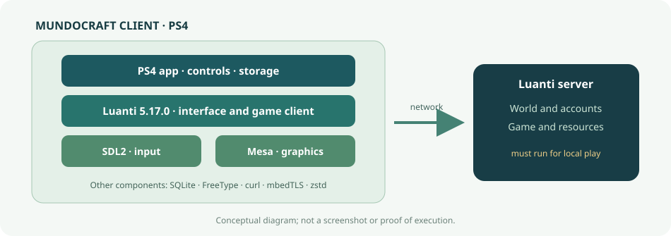
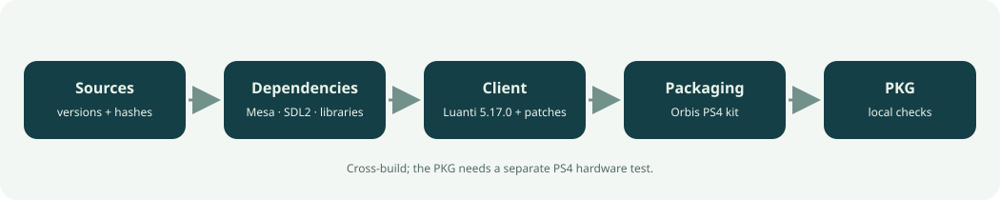

# Architecture

MundoCraft uses the open-source Luanti 5.17.0 engine with a PS4 platform layer. The client renders and controls the game; the Luanti server hosts the world, accounts, and game resources.

## Client layers

- **PS4 application:** configures application startup and data paths with Title ID `LUNT00001`.
- **Port adapters:** connect input, storage, networking, and platform behavior to the APIs available on PS4. Engine changes are recorded as patches in `client/patches/`.
- **Luanti:** provides the game client, interface, client-side world logic, and loading of resources supplied by the server.
- **Graphics and input:** SDL2 connects controls and the window; Mesa provides the PS4 graphics libraries used for rendering.
- **Libraries:** SQLite, FreeType, zstd, curl, and mbedTLS provide storage, fonts, compression, and encrypted connections. The lockfiles document versions and hashes.
- **Server:** processes the world, identities, and progress. A LAN game requires the server to be running.

The PKG does not include Mineclonia or other Luanti games. The server you connect to supplies game content.

## Build and packaging

The [BUILDING.md](BUILDING.md) recipe compiles the native dependencies and client for PS4, then packages the executable with required resources and modules. The `orbis-sdk-v1` kit from `orbis-ports/orbis-porting-kit` provides the target toolchain and packaging tools. The OpenOrbis module-source archive is pinned separately to rebuild the required modules. Neither the kit nor its tools are part of this repository or source archive.

The build produces a PKG with Title ID `LUNT00001` and `APP_VER` `01.19`. The product's semantic version is `0.3.19-alpha1`; changing one does not automatically change the other.

The diagrams explain the software structure. They are illustrations, not screenshots or evidence that this version ran on a PS4.
